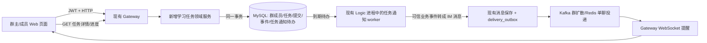

# IM-P1 架构方案与决策

状态：**原始架构设计**；实际落地和差异见 [IM-P1 验收记录](../evidence/im-p1-evidence.md)。需求与可观察结果见 [specification.md](./specification.md)，源码边界见 [discovery.md](./discovery.md)。本轮不引入任务微服务、课程系统或新的消息中间件。

## 1. 业务执行图

**权威数据流**：HTTP 写请求从 JWT 得到操作者，领域服务在 MySQL 中校验群身份和状态、修改任务/提交，并插入 `task_events` 与 `task_notification_outbox` 后提交。HTTP 成功只承诺业务事务成功。Logic 进程的 worker 读取待办，通过受限的内部发布器把事件变成一条**持久 IM 消息**；后续复用消息 Outbox、群 Kafka/Transfer、Redis/Gateway、WebSocket ACK 和历史查询。页面收到提醒后再 GET 任务详情，不用聊天正文计算任务状态。

## 2. 架构决策记录

### ADR-01：沿用当前 Gateway + Logic + Transfer，不新增任务微服务

任务 API 由 Gateway 接入，领域规则集中在新的 `internal/learningtask` 包，MySQL 与 `group_members` 仍是事实来源。Gateway 现已持有 DB 并处理群创建、红包，短期在这个进程加路由最少改现有传输架构；领域服务独立于 HTTP handler，可在后续迁出而不重写状态机。**代价**是 Gateway 仍承担业务读写，与理想的“网关只管连接”不同；通过包边界、薄 handler、事务服务和独立测试控制维护成本。不能在简历中说任务已是独立微服务。

### ADR-02：任务状态与权限直接查 MySQL 群成员表

所有读写先确认 `im_groups.status='active'` 和 `group_members.status='active'`，再按 `role` 授权；写操作在事务内锁定相关行。角色不从页面按钮或 Redis `group_members:*` 推断。当前 `isActiveGroupMember` 同时检查禁言，不适用于交作业或审核；学习任务单独定义读、提交、管理三项权限。群主/管理员可管理，普通成员可提交自己的内容。非成员与移除成员读写均拒绝；管理员也不能把他人的提交当自己的提交。

成员变化的语义是**当前成员制**：后来加入的普通成员能看已发布任务并提交；离开的成员不能再读，旧提交留在审计中但不进当前进度分母。通知在业务事务中确定目标类别，在实际构造 IM 消息前再次检查目标仍活跃；移除后的旧提醒可能已在网络链路中，提醒不含答案或审核理由，详情 API 始终重新鉴权。这是 P1 的安全边界，不声称可撤回已交付的消息。

### ADR-03：任务、提交与事件同一 MySQL 事务；并发靠行锁和版本

建议迁移新增四张表：

| 表 | 关键字段/约束 | 作用 |
| --- | --- | --- |
| `group_tasks` | `task_id PK,group_id,title,description,due_at,status,version,created_by,published_at,closed_at,created_at,updated_at`；索引 `(group_id,status,created_at,task_id)` | 任务事实与 `draft/published/closed` |
| `task_submissions` | `submission_id PK,task_id,user_id,text,link,status,attempt_no,version,reviewer_id,review_note,submitted_at,reviewed_at`；唯一 `(task_id,user_id)`；索引 `(task_id,status,user_id)` | 每人当前提交与审核状态 |
| `task_events` | `event_id PK,task_id,submission_id?,actor_uid,action,request_id,request_hash,payload_json,result_json,created_at`；唯一 `(actor_uid,request_id)` | 幂等响应与不可变业务审计；历史提交正文仅在受控 DB 内留存 |
| `task_notification_outbox` | `id PK,event_id,target_type,target_id,status,attempts,available_at,lease_generation,im_message_id,last_error,created_at,updated_at`；唯一 `(event_id,target_type,target_id)`；待办索引 `(status,available_at,id)` | 任务事件到 IM 消息的可靠交接 |

所有时间用 UTC 毫秒时间戳，业务服务负责限制字段长度；`request_id` 用客户端 UUID，业务服务计算包含操作、目标与规范化请求体的 `request_hash`。同一操作者复用同一 ID 且哈希相同，返回事件保存的 `result_json`；哈希不同返回 409。事件 ID 由服务端生成，**不等于 IM `message_id`**。

写操作统一锁顺序：先任务行 `FOR UPDATE`，再相关群成员行，最后提交行。数据库约束和行锁保证同一成员只有一个当前提交；提交和审核带 `expected_version`，另一操作者已更新则 409。创建草稿时尚无任务行，先锁群/成员并用唯一请求事件约束幂等。后续群成员变更实现必须用同一成员行更新，才能与提交权限检查串行化。通过审计事件保存每次重交内容和审核结论，当前提交行只保存最新版本。事务不调用 Redis、Kafka 或 WebSocket。

### ADR-04：新增**任务通知待办**，再复用**消息投递 Outbox**

不能直接把任务事件写进现有 `delivery_outbox`：该表按 `message_id` 与 `messages` 做 JOIN，要求消息已存在；`conversation_outbox` 只更新会话摘要。更不能让 HTTP 在业务提交后直接调 Kafka，因这会出现“任务已发布而通知丢失”。因此新增小型 `task_notification_outbox`，与业务事实同事务写入。

Logic 进程增加一个任务待办 worker：条件更新领取到期行（带租约代次），读取 `task_events`、任务和当前成员，构造**固定模板**提醒，调用内部 `PublishTaskEvent(event_id,target)`。该入口只接收数据库事件 ID，不接收浏览器传入的任意发送者、收件人或正文，也不暴露为外部普通 `PushMessage`。任务系统账号（独立于 AI Bot，固定内部 UID）发送 IM 消息，`client_msg_id = task_event:<event_id>:<target>`；保存时硬性要求现有消息、`conversation_outbox`、`delivery_outbox` 在同一事务可用，禁用旧 Schema 降级直写。消息保存成功后，任务待办才标 `done`。若 Redis 分配 seq、MySQL、Kafka/Redis 失败，分别由任务待办或消息投递 Outbox 继续重试。

同一事件消息持久化重试时，由 `(from_uid,client_msg_id)` 唯一键找回原 IM 消息，避免产生第二条消息；Kafka/Redis 到客户端仍是**至少一次**，客户端按 `message_id` 去重。`task_notification_outbox.done` 表示 IM 消息已入库，`delivery_outbox.done` 表示外部分发尝试完成，二者均**不代表成员阅读或客户端 ACK**。任务通知最多尝试固定次数（建议 10 次），之后留 `dead` 和错误供手动重放；若后续 IM `delivery_outbox` 本身进入 `dead`，也要对该消息单独排查/重放，不能误以为任务待办会再次发送。业务任务不回滚，成员仍可通过 HTTP 看权威状态。

发布/关闭的目标是 `group`，群提醒仅含标题、任务 ID 和动作；成员提交后的目标是提交时仍活跃的 owner/admin 用户；审核结果的目标是提交者本人。私信通知不要求审核者与成员为好友，因为它由**受限内部系统发布器**生成，不能复用对外 `PushMessage` 的普通好友权限捷径。审核理由只通过受权任务详情给本人，避免泄漏到群消息。目标若在发送前已离群则任务通知标为 `skipped` 并留原因；群消息落库后的既有投递链仍可能有在途提醒，不承诺撤回。

### ADR-05：Web 客户端使用任务 HTTP 状态，WebSocket 只促刷新

在现有 `public/index.html` 的群会话旁加“学习任务”页签/面板：管理员草稿与发布、成员提交、管理员审核与进度。沿用页面内存 JWT、现有会话切换和 WebSocket 消息展示；点击任务提醒或切换群时按群 ID 调任务 HTTP 列表。刷新后 MySQL 任务仍可重载，不依赖 IndexedDB 存任务事实；可在本地保存草稿输入，但页面不得以其为权威状态。群聊天仍走现有协议，不要求改造前端成 React 才算 IM-P1 完成。

## 3. 为什么选这个方案

| 常见方案 | 本轮选择与原因 |
| --- | --- |
| 只在聊天里发“交作业”文本 | 无可靠的个人提交、审核、进度和权限，不符合业务目标。 |
| 任务 API 写 DB 后同步发 WebSocket/Kafka | DB 与外部投递跨系统不能原子提交，失败窗口会丢通知。 |
| 把任务事件直接塞现有 `delivery_outbox` | 现有 worker 要 JOIN `messages`，业务事件没有 IM 消息行；需要明确交接层。 |
| 新建任务微服务、MQ、搜索引擎 | P1 状态和数据规模不要求，反而增加跨服务事务与部署成本。 |
| 所有任务更新都群广播 | 审核理由和答案可能泄漏；提交与审核结果走定向提醒，详情仍按权限查。 |
| 只靠客户端去重/禁用按钮防重复 | 多标签页、网络重试、并发审核仍可产生重复；必须有 DB 唯一键、行锁和版本。 |

## 4. 兼容、迁移与风险

1. 迁移只 **CREATE 新表/索引与必要的内部系统用户**；不改既有消息、群成员和红包表结构，不重建原有数据。先在独立测试库对 `sql/init.sql` 与增量迁移双路径验证；新版本先部署迁移，再启用任务路由/worker。关闭新路由和 worker 可回退功能，已写任务数据保留。
2. `delivery_outbox` 和其迁移当前尚未提交。IM-P1 的可靠通知验收必须先固定这部分基线并确保运行配置启用，不能在缺表/关闭开关时悄悄退化成“尽力发送”。
3. 当前 `PushMessage` 对群要求发送者是活跃成员、对私聊要求好友；内部系统通知需要受限专门入口。若把系统账号当普通用户直接伪造 `PushMsgReq.UserId`，会造成权限漏洞，这种实现不接受。
4. 任务详情要在最终读取时检查当前群权限。普通成员只能看到自己的提交、退回理由；管理员可查所有，审计操作要记 actor。SQL 必须按群 ID 与 task ID 一起限制访问，不能只根据前端选择的群。
5. 当前群成员变更没有 HTTP API；P1 不扩展成员管理，但测试必须用夹具改变 `group_members.status/role`，验证已移除成员无法继续读/写、已入群成员按当前规则被统计。
6. 如果后续 P2 增加课程/章节，可在 `group_tasks` 加可空 `course_id/chapter_id` 和迁移映射，既有群任务保持 `NULL`。P1 不预造课程表。

## 5. 评审结论与待确认项

本轮规格给出的默认选择是：当前成员制、管理员不交作业、发布后题目不可改、关闭前待审核数必须为零、提醒正文不含用户答案与退回理由。这些选择使状态和权限可以直接验证；如果实际产品需要“发布后改题”“已退群者仍看旧作业”“管理员也参与答题”，应在实施前改规格和验收用例。设计审查目前只做了本轮源码自查，尚无独立实施审查；不能把方案标记为已批准或已落地。
